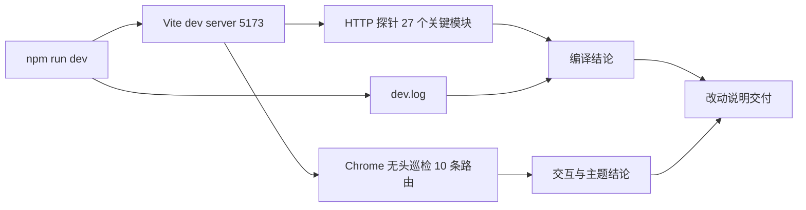

## User Requirements

任务 6 是 Soren UI 改造项目的收尾交付环节：重新启动 `npm run dev` 并证明“无报错可运行”，随后逐项输出改动说明。

## Product Overview

Soren UI 已完成代码改造（品牌、首页、四分类组件库、预览/源码/复制能力），本任务不再做功能开发，只做**启动验证 + 交付说明**，并对验证中暴露的问题做最小修复。

## Core Features

- **服务启动**：在 `e:/dsh-demo/react-bits-main` 后台启动 `npm run dev`，日志落盘到 `dev.log`，确认出现 `VITE ready` 且端口可访问（5173 若被本机其他项目占用，则记录真实端口并在说明中同步地址）。
- **启动零报错**：日志中不出现 error / failed / 500，也不出现找不到模块、Tailwind 编译失败等字样。
- **页面可用性校验**：访问根路径返回 200，页面 `<title>` 为 `Soren UI`；首页显示 “My Personal Component Library” 与两个按钮；`/docs`、`/tools`、`/c/buttons`、四个组件页均可打开；未知路径落到 404。
- **能力校验**：组件页 Preview/Code Tab 可切换，Code 区展示源码（带行号、文件切换 `.jsx` / `.css`），点击复制后剪贴板内容正确且按钮短暂显示 Copied；侧栏四分类导航可见；暗色为默认主题且可切浅色；移动端不横向溢出。
- **改动说明交付**：按“配置入口 / 站点外壳 / 页面路由 / 组件库 / 文案与品牌 / 待手动清理”分组，逐文件列出改动位置与内容，附访问地址、停止/重启方式与后续新增组件、分类的扩展方式。

## Visual Effect

保持原站深色简约科技风：`#120f17` 背景、紫色 `#a855f7` 强调、Geist 字体、毛玻璃顶部导航、点阵网格预览画布。

## Scope Boundary

不新增功能、不改索引系统与设计风格；原作者遗留目录的批量删除仍不自动执行（受 IDE 安全删除守卫限制），仅在交付说明中给出手动命令。

## Tech Stack Selection

沿用现有栈，不引入新依赖：Vite 5.4.21 + React 19 + React Router 6 + Tailwind v4（`@tailwindcss/vite`）+ next-themes；验证侧使用 Windows PowerShell、Node v24.16.0、本机 Chrome 无头模式，脚本依赖安装在 `%TEMP%/soren-verify`（`puppeteer-core`），**不污染项目依赖**。

## Implementation Approach

采用“分层验证 + 证据留存”的方式，而不是只看启动日志：

1. **进程层**：先按 `CommandLine` 包含 `react-bits-main` 精确筛选并停止遗留 node 进程（避免误杀 `E:/dsh-demo/react-ui` 等其他项目），再以 `Start-Process cmd /c "npm run dev > dev.log 2>&1"` 后台启动，`Start-Sleep` 后读取 `dev.log` 尾部确认 `ready in ... ms` 与端口。
2. **HTTP/编译层**：`Invoke-WebRequest` 验证 `/` 返回 200 且 title 正确；再逐个请求 `src` 下 27 个关键模块（入口、App、styles.css、site 外壳与页面、registry、4 组组件的 `.jsx` 与 `demo.jsx`）。Vite 对模块转换失败会返回 500，因此这一步等价于“全部导入链编译通过”的快速探针。
3. **真实浏览器层**：用 `puppeteer-core` 指向本机 Chrome，串行遍历 10 条路由，收集 `console.error` 与 `pageerror`，断言 `h1`、`.sp-tab`、`.sp-file`、`.code-line` 数量；对 `/c/buttons/button` 点击 Code Tab、点击 `.sp-copy`，并通过 `overridePermissions(origin, ['clipboard-read','clipboard-write','clipboard-sanitized-write'])` 读回剪贴板文本；再以 390px 视口验证侧栏 `display:none` 与 chip 存在、`scrollWidth <= innerWidth`；最后写入 `localStorage['soren-ui-theme']='light'` 复检主题切换。
4. **静态与构建层**：`read_lints` 检查新增文件诊断；必要时 `npm run build` 复核生产编译（上轮 1723 modules，18.74s）。
5. **问题修复**：仅在验证失败时改代码，修复范围限定在 `src/App.jsx`、`src/site/**`、`src/library/**`、`src/css/soren.css`、`src/theme/color-mode.jsx`，改完重跑第 2-4 层。

关键取舍：不新增测试框架（项目无测试基建，属于一次性交付验证）；不把 `puppeteer-core` 写进 `package.json`，避免为一次性验证污染依赖与锁文件。

## Implementation Notes

- **进程与端口**：本机历史上 5173 曾被 `E:/dsh-demo/react-ui` 以 `--strictPort` 占用；若 `npm run dev` 自动递增端口，必须在交付说明中写明真实地址（如 5174），必要时用 `npm run dev -- --port 5174 --strictPort` 固定。
- **日志与降噪**：`dev.log` 已被 `.gitignore` 的 `*.log` 覆盖，可直接留在根目录；只 `Get-Content -Tail 20`，不整份回显。
- **清理边界**：不再自动执行 `Remove-Item` 批量删除（上轮触发安全守卫，>500 文件需用户在 IDE 确认）；遗留目录当前不被任何代码引用，`styles.css` 的 `@import 'tailwindcss' source(none)` 也已阻断 Tailwind 扫描，不影响启动与构建。
- **验证脚本位置**：`C:/Users/SZH/AppData/Local/Temp/soren-verify/check.mjs` 等脚本放在仓库外，避免交付物里出现临时文件。
- **交付要求**：说明中每条结论必须附可复现证据（命令、状态码、日志行、断言结果），未验证项需显式标注为未验证，不臆测。

## Architecture Design

验证链路与现有工程结构对应关系：



不新增架构层次，仅复用现有 `src/site`（外壳与页面）、`src/library`（组件自动注册）、`src/css/soren.css`（样式令牌），验证脚本全部在仓库外。

## Directory Structure

本次任务原则上**不改业务代码**，只产生运行日志与仓库外脚本；若验证失败才按“修复落点”改动。

```
e:/dsh-demo/react-bits-main/
├── package.json                      # [READ] 确认 dev=vite、无遗留脚本
├── vite.config.js                    # [READ] 确认 port 5173、插件与 alias
├── index.html                        # [READ] 校验 title/meta 与主题启动脚本
├── dev.log                           # [NEW] dev 启动日志（已被 .gitignore 忽略）
└── src/
    ├── App.jsx                       # [READ] 路由表与 Provider 装配
    ├── styles.css                    # [READ] Tailwind source(none) 与三个 CSS 引入
    ├── css/soren.css                 # [FIX-IF-NEEDED] 布局/间距/主题异常时修复
    ├── theme/color-mode.jsx          # [FIX-IF-NEEDED] 主题切换异常时修复
    ├── site/                         # [FIX-IF-NEEDED] 外壳与页面渲染异常时修复
    └── library/                      # [FIX-IF-NEEDED] 组注册或 demo 加载异常时修复

C:/Users/SZH/AppData/Local/Temp/soren-verify/
├── check.mjs                         # [REUSE/NEW] 10 路由 + Code Tab + 复制巡检
├── check4.mjs                        # [REUSE] 浅色主题巡检
└── node_modules/puppeteer-core       # [EXISTING] 仓库外验证依赖
```